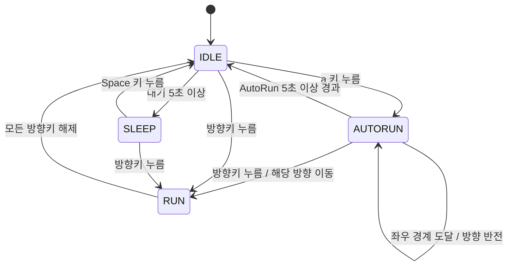

# DRILL #11 개발 기획·요구사항 문서

## 1. 과제 개요

- **과제명:** 소년 — 자동 무적 런(AutoRun) 상태 추가
- **목표:** 기존 `boy.py`와 `main.py`를 이어서 사용하여 소년 캐릭터에 AutoRun 상태를 추가한다.
- **개발 환경:** Python, pico2d, transitions
- **기본 실행 파일:** `main.py`
- **문서 상태:** 개발 전 계획을 바탕으로 로컬 구현·검증 완료. GitHub 업로드와 e-Class 제출은 미완료이며, 마지막 절에 구현 결과를 기록한다.

## 2. 기존 구조 및 개발 범위

현재 `main.py`는 입력 처리, 월드 업데이트, 렌더링을 반복하고 `Boy`에 이벤트를 전달한다. `boy.py`는 `transitions.Machine`으로 IDLE, SLEEP, RUN 상태를 관리한다. IDLE에서 5초가 지나면 SLEEP으로 전환하고, 방향키로 RUN 상태에 진입한다.

기존 실행 흐름과 IDLE·SLEEP·RUN 동작을 유지하면서 AutoRun을 확장한다. 과제에서 **AutoRun 상태 클래스 추가를 명시**했으므로, 상태 이름만 추가하지 않고 별도 `AutoRun` 클래스를 정의한다. 기존 상태 머신에 AUTORUN을 등록하고 해당 클래스가 진입·갱신·그리기·종료 동작을 담당하도록 연결한다.

## 3. 기능 요구사항

| ID | 요구사항 | 완료 기준 |
| --- | --- | --- |
| FR-01 | IDLE에서 `a` 키를 누르면 AutoRun에 진입한다. | 방향키를 누르지 않아도 이동과 달리기 애니메이션이 계속된다. |
| FR-02 | AutoRun에서는 일반 RUN보다 빠르게 이동한다. | 같은 시간 동안 일반 RUN보다 이동 거리가 길다. |
| FR-03 | AutoRun에서는 소년의 크기를 확대한다. | 일반 상태보다 크게 표시되고 종료하면 원래 크기로 돌아온다. |
| FR-04 | 화면 좌우 끝에서 자동으로 방향을 전환한다. | 확대된 캐릭터의 표시 크기를 고려하여 화면 안에서 왕복하고, 바라보는 방향과 애니메이션도 바뀐다. |
| FR-05 | AutoRun 진입 후 5초 이상 경과하면 IDLE로 복귀한다. | 진입 시각을 기준으로 실제 경과 시간을 측정하고, 5초 이상이 된 첫 업데이트에서 이동을 멈춘다. |
| FR-06 | AutoRun 중 왼쪽 또는 오른쪽 방향키를 누르면 RUN으로 전환한다. | AutoRun을 즉시 취소하고 누른 방향으로 일반 속도·크기로 이동한다. |
| FR-07 | 별도의 `AutoRun` 상태 클래스를 추가한다. | 클래스가 실제 상태 동작을 수행하며 기존 상태 머신과 연결되어 있다. |
| FR-08 | 기존 조작과 상태 동작을 유지한다. | 방향키 이동·해제, IDLE에서 SLEEP 전환, SLEEP에서 Space로 깨우기, ESC·창 닫기 종료가 동작한다. |

### 구현 시 적용할 기준

- AutoRun 최초 이동 방향은 진입 직전 소년이 바라보던 방향으로 한다.
- 일반 RUN 대비 **이동 속도 2배, 표시 크기 2배**를 초기 설정으로 사용한다. 과제는 증가 배율을 지정하지 않았으므로 이는 구현 선택이다.
- AutoRun 중 `a` 키를 다시 눌러도 지속 시간을 초기화하지 않는다.
- AutoRun 진입은 IDLE에서만 허용한다. RUN·SLEEP에서 `a`를 눌러도 전환하지 않는다.
- 방향키를 누른 이벤트로 AutoRun을 취소하며, 키 해제만으로는 취소하지 않는다.
- AutoRun 종료 시 확대 효과와 자동 이동을 해제한다. IDLE로 복귀하면 기존 대기 시간을 새로 측정한다.
- '무적'은 과제에서 사용한 상태 명칭이다. 현재 코드에 피격·충돌 피해 기능이 없으므로 별도 전투·피해 시스템은 개발 범위에 포함하지 않는다.

## 4. 상태 전환 계획

| 현재 상태 | 조건·입력 | 다음 상태 | 처리 |
| --- | --- | --- | --- |
| IDLE | `a` 키 누름 | AUTORUN | 시작 시각 기록, 속도·크기 증가, 자동 이동 시작 |
| AUTORUN | 진입 후 5초 이상 경과 | IDLE | 자동 이동 종료, 크기 복원, IDLE 대기 시간 초기화 |
| AUTORUN | 왼쪽 방향키 누름 | RUN | 자동 이동 종료, 크기·속도 복원, 왼쪽 이동 |
| AUTORUN | 오른쪽 방향키 누름 | RUN | 자동 이동 종료, 크기·속도 복원, 오른쪽 이동 |
| AUTORUN | 좌우 화면 경계 도달 | AUTORUN | 위치를 화면 안으로 보정하고 이동 방향 반전 |
| IDLE·SLEEP | 방향키 누름 | RUN | 기존 일반 이동 |
| RUN | 모든 방향키 해제 | IDLE | 기존 이동 종료 |
| IDLE | 대기 5초 이상 | SLEEP | 기존 수면 동작 |
| SLEEP | Space 키 누름 | IDLE | 기존 깨우기 동작 |

아래 도식은 제출용 상태 다이어그램 이미지의 설계 원본이다. **최종 제출 전 별도 이미지 파일로 제작하여 저장소에 포함해야 한다.**

## 5. 파일별 구현 계획

| 파일 | 역할·작업 계획 |
| --- | --- |
| `boy.py` | AutoRun 클래스 및 상태 연결, a 키 입력, 시간 측정, 자동 이동·반사, 확대 렌더링, 종료 복원 구현 |
| `main.py` | 기존 이벤트 전달과 게임 루프 재사용. 통합에 필요한 경우에만 수정 |
| `grass.py` | 기존 바닥 객체 유지 |
| `animation_sheet.png` | 기존 소년 애니메이션 이미지 재사용 |
| `grass.png` | 기존 바닥 이미지 재사용 |
| `PRD.md` | 개발 요구사항과 검증·제출 기준 기록 |
| `state_diagram.png` | 최종 구현과 일치하는 상태 다이어그램 이미지 제작 예정 |
| `README.md` | 의존성 설치, 실행 방법, 조작법, 제출 자료 안내 작성 예정 |

## 6. 개발 순서 및 커밋 계획

실제 작업 단위별로 변경 내용을 검토하고 커밋한다. 완성 후 과거 개발 기록을 꾸미거나 의미 없는 커밋으로 나누지 않는다.

1. PRD 작성 및 검토: `docs: add Drill 11 requirements and development plan`
2. AutoRun 클래스·상태 전환·시간 제한 구현: `feat: add AutoRun state and timed transitions`
3. 속도·크기 증가 및 경계 반사 구현: `feat: add AutoRun movement and visual effects`
4. 방향키 취소 및 기존 동작 검증, 발견한 문제 수정: 실제 변경 내용에 맞는 커밋 메시지 사용
5. 상태 다이어그램 이미지·실행 안내 추가 및 제출 파일 확인: `docs: add state diagram and run instructions`

계획 작성 당시 DRILL_11 폴더는 Git 저장소로 초기화되어 있지 않았다. 구현 단계에서는 로컬 저장소에 PRD를 먼저 커밋하고 실제 진행에 맞춰 변경을 기록했다. 모든 최종 커밋 메시지는 한국어로 작성한다.

## 7. 검증 계획

| 항목 | 검증 방법 | 기대 결과 |
| --- | --- | --- |
| 진입 및 자동 이동 | IDLE에서 a를 누르고 키를 놓는다. | AUTORUN으로 바뀌고 계속 이동한다. |
| 속도 및 크기 | 일반 RUN과 AutoRun을 비교한다. | AutoRun의 이동 속도와 표시 크기가 각각 2배다. |
| 좌우 경계 | AutoRun으로 양쪽 경계에 도달시킨다. | 화면 안에서 반사하고 방향별 달리기 이미지가 일치한다. |
| 시간 제한 | AutoRun 진입 시점부터 시간을 확인한다. | 5초 미만에는 유지하고 5초 이상이 되면 IDLE로 복귀한다. |
| 중복 입력 | AutoRun 도중 a를 다시 누른다. | 최초 진입 후 5초 기준을 유지한다. |
| 방향키 취소 | AutoRun에서 왼쪽·오른쪽을 각각 누른다. | 즉시 일반 RUN으로 전환하여 해당 방향으로 이동하고 크기·속도가 복원된다. |
| 취소 후 키 해제 | 방향키 취소 후 모든 방향키를 놓는다. | 기존 규칙에 따라 IDLE로 돌아간다. |
| 기존 상태 | 일반 이동, 양쪽 키 입력, 수면·깨우기를 실행한다. | 기존 입력 우선순위와 상태 전환이 유지된다. |
| 종료 및 리소스 | main.py 실행 후 ESC·창 닫기를 각각 확인한다. | 이미지 로딩 오류 없이 실행되고 정상 종료된다. |

## 8. 채점 기준 대응

| 공지 채점 기준 | 배점 | 대응 항목 |
| --- | --- | --- |
| a 입력으로 AutoRun 이동 | 1점 | FR-01, FR-07 |
| 5초 이상 경과 후 IDLE 복귀 | 1점 | FR-05 |
| AutoRun 속도 증가 및 크기 확대 | 1점 | FR-02, FR-03 |
| 좌우 끝 자동 방향 전환 | 1점 | FR-04 |
| 상태 다이어그램 제출 | 1점 | `state_diagram.png` 제작·업로드 확인 |

방향키 취소 동작 역시 공지된 필수 기능이므로 별도로 구현하고 검증한다.

## 9. 제출 체크리스트

- [ ] 과제 전용 GitHub 저장소를 생성하고 **Public(공개)**으로 설정한다.
- [x] PRD를 포함하고 실제 개발 과정의 충분하고 적절한 로컬 커밋 기록을 남긴다. 원격 업로드 확인은 별도 항목이며, 공지상 기록 미준수 시 0점 처리될 수 있다.
- [ ] `main.py`, `boy.py`, `grass.py` 등 실행에 필요한 코드를 업로드한다.
- [ ] `animation_sheet.png`, `grass.png` 등 실행에 필요한 이미지를 업로드한다.
- [ ] 최종 상태 다이어그램을 **이미지 파일**로 저장하여 함께 업로드한다. Mermaid 원문만으로 제출을 끝내지 않는다.
- [x] README에 의존성(`pico2d`, `transitions`), 실행 방법(`python main.py`), 조작법을 기록한다.
- [ ] GitHub 웹 화면에서 코드·이미지·문서와 커밋 기록의 업로드를 확인한다.
- [ ] 별도 위치에 저장소를 내려받아 필요한 파일 누락 없이 실행되는지 확인한다.
- [ ] e-Class에 **`.git`으로 끝나는 해당 저장소 주소**를 제출한다.
- [ ] 수업 시간 내 실습을 수행하고, 공지된 마감 시각까지 e-Class 제출을 완료한다.
- [ ] AI 사용 개발 및 제출 방법은 디스코드에 공지된 실습 과제 제출 요령을 확인하여 따른다.

마감 시각과 디스코드 공지의 세부 내용은 제공되지 않았으므로 임의로 기재하지 않는다. 저장소 생성·업로드·e-Class 제출은 PRD 작성 이후 진행할 작업이다.

## 10. 구현 결과 및 검증 기록

- `boy.py`에 별도 `AutoRun` 클래스를 추가하고 기존 상태 머신의 진입·종료·갱신·그리기와 연결했다.
- IDLE의 a 입력, 5초 만료, 방향키 취소, 일반 상태의 수면·깨우기·키 입력 우선순위를 구현·유지했다.
- 자동 이동 속도는 1,000px/초, 일반 이동은 500px/초다. 표시 크기는 각각 200×200, 100×100이다.
- 확대 상태에서 화면 내부 위치를 보정하고 좌우 경계에서 반사한다. 한 프레임에 여러 경계를 지날 만큼 지연되어도 이동 거리를 반영한다.
- `main.py`는 실제 경과 시간을 월드 객체에 전달한다. 실행 진입점을 분리하고 오류·종료 시 캔버스를 닫는다.
- 상태·시간·경계·렌더링 호출·메인 루프에 대한 자동 테스트 **19개가 통과**했다.
- 실제 SDL 소프트웨어 렌더러로 이미지를 로딩하고 이벤트를 전달한 실행 점검에서 AutoRun **5.011초 후 복귀**, **경계 반사 8회**, 양쪽 방향키 취소, ESC·창 닫기 이벤트 종료를 확인했다. 이 결과는 자동 실행 점검이며 사용자의 수동 조작 완료를 뜻하지 않는다.
- 상태별 SDL 렌더링 PNG를 생성하여 기본 크기, 확대 상태, 취소 후 크기 복원을 시각적으로 확인했다.
- `state_diagram.png`는 한국어 제목·설명·전환 조건과 코드의 상태 이름을 함께 표기한 제출용 이미지로 완성했다.
- `requirements.txt`, `README.md`, 다이어그램 재생성 및 실행 점검 도구를 추가했다.
- 원격 저장소는 아직 등록되지 않았다. Public 저장소 생성·푸시·웹 업로드 확인 및 e-Class 제출은 남아 있다.
