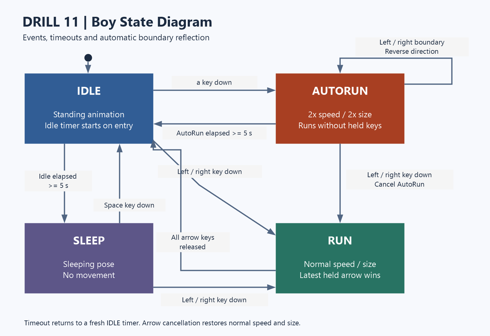

# DRILL 11 — 소년 자동 무적 런

기존 `boy.py`와 `main.py`를 확장하여 별도 `AutoRun` 클래스로 자동 무적 런 상태를 구현한 pico2d 실습 과제입니다.

## 설치 및 실행

Python 3.10.11 / Windows에서 검증했습니다. 아래 명령은 저장소 폴더에서 실행합니다.

```powershell
python -m pip install -r requirements.txt
python main.py
```

800×600 창이 열립니다. `animation_sheet.png`와 `grass.png`는 파이썬 파일과 같은 폴더에 있어야 합니다. 이미지 경로는 소스 파일 위치를 기준으로 읽으므로 다른 작업 폴더에서 `main.py`의 전체 경로로 실행해도 됩니다.

## 조작법

| 입력·조건 | 동작 |
| --- | --- |
| 왼쪽 / 오른쪽 방향키 | 일반 달리기. 양쪽을 함께 누르면 마지막에 누른 방향 우선 |
| 모든 방향키 놓기 | 일반 달리기에서 대기로 전환 |
| 대기 상태에서 `a` | 자동 무적 런 시작 |
| 자동 무적 런 중 방향키 누르기 | 자동 무적 런을 취소하고 누른 방향으로 일반 달리기 |
| 자동 무적 런 시작 후 5초 경과 | 대기로 돌아감 |
| 대기 상태에서 5초 경과 | 수면으로 전환 |
| 수면 상태에서 Space | 대기로 복귀. 방향키를 누르면 바로 일반 달리기 |
| ESC / 창 닫기 | 종료 |

자동 무적 런은 키 조작 없이 **일반 속도의 2배(1,000px/초)**로 달리며 **크기도 2배(200×200)**가 됩니다. 확대 크기를 고려해 화면 좌우 끝에서 자동으로 방향을 반전합니다. 중간에 `a`를 다시 눌러도 5초 제한이 연장되지 않습니다. 종료하면 기본 속도(500px/초)와 크기(100×100)로 돌아갑니다.

'무적'은 공지된 상태 이름이며, 이번 실습에는 전투·피격 시스템이 없습니다.

## 파일 안내

- [PRD.md](PRD.md): 개발 전 요구사항, 구현 계획, 제출 체크리스트와 구현 결과
- `boy.py`: 기존 상태 머신과 별도 `AutoRun` 클래스
- `main.py`, `grass.py`: 게임 루프와 배경 객체
- `animation_sheet.png`, `grass.png`: 실행에 필요한 이미지
- [state_diagram.png](state_diagram.png): 한국어 상태 다이어그램 제출 이미지
- `tests/`: 화면 없이 실행하는 상태·이동·게임 루프 회귀 테스트
- `tools/smoke_game.py`: 실제 SDL 이벤트·텍스처·5초 타이머 실행 점검
- `boys_team_10000.py`, `run_animation.png`, `ball21x21.png`, `ball41x41.png`: 원본 수업 자료 보존용. 본 과제 실행 진입점은 `main.py`

## 상태 다이어그램



이미지는 다음 명령으로 다시 생성할 수 있습니다. Windows의 맑은 고딕과 System.Drawing을 사용하며 게임 실행에는 이 도구가 필요하지 않습니다.

```powershell
powershell -NoProfile -ExecutionPolicy Bypass -File tools/render_state_diagram.ps1
```

## 검증

```powershell
python -m unittest discover -s tests -v
python -m compileall -q boy.py main.py grass.py tests tools/smoke_game.py
python tools/smoke_game.py --output-dir "$env:TEMP/drill11-smoke"
```

마지막 명령은 화면에 창을 표시하지 않는 SDL 소프트웨어 렌더러로 실제 이미지를 읽고, 입력 이벤트·경계 반사·실제 5초 경과·취소·종료를 확인합니다. 지정 폴더에 상태별 PNG와 `result.json`을 생성합니다.

## 제출 전 확인

1. 이 과제만의 GitHub **Public 저장소**를 만들고 커밋 이력을 포함해 올립니다.
2. 코드, 이미지, PRD, 상태 다이어그램이 GitHub에 올라갔는지 확인합니다.
3. 내려받은 저장소에서도 실행되는지 확인합니다.
4. e-Class에 **`.git`으로 끝나는 저장소 주소**를 마감 시각까지 제출합니다.
5. AI 사용 개발·제출은 디스코드 공지 요령을 확인하여 따릅니다.

마감 시각과 디스코드 세부 공지는 제공되지 않아 기재하지 않았습니다. 실제 GitHub 업로드 여부와 e-Class 제출 여부는 별도로 확인해야 합니다.
